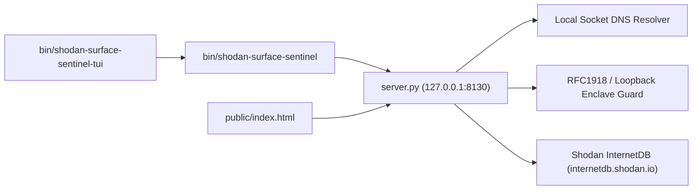

# Shodan Attack Surface Sentinel

[](https://zoth.nullai.tech/tools/shodan-surface-sentinel)
[](http://127.0.0.1:8130)
[](LICENSE)

Passive attack surface auditor and Shodan InternetDB reconnaissance workstation. Queries indexed port exposures, Common Platform Enumeration (CPE) software stacks, reverse hostnames, and confirmed CVE vulnerabilities without sending intrusive active probing packets.

## Overview

**Shodan Attack Surface Sentinel** (`shodan-surface-sentinel`) is a zero-dependency Python 3 HTTP service, CLI inspector, and browser workstation integrated into **Zoth Studio v2** (`https://zoth.nullai.tech/tools/shodan-surface-sentinel`) and **ZothOS v3.4.0**.

| Property | Value |
| :--- | :--- |
| **Tool ID** | `shodan-surface-sentinel` |
| **Category** | `Security & Enclave` |
| **Loopback Bind** | `127.0.0.1:8130` |
| **Zoth Studio v2 Dossier** | `https://zoth.nullai.tech/tools/shodan-surface-sentinel` |
| **Local Studio Route** | `http://127.0.0.1:3000/tools/shodan-surface-sentinel` |
| **Runtime Dependencies** | Python 3.10+ standard library (`http.server`, `socket`, `urllib`) |
| **License** | MIT (100% free and open-source) |

## Architecture



- **`server.py`**: Standard-library `HTTPServer` daemon bound to `127.0.0.1:8130` by default. Resolves hostnames via `socket.gethostbyname`, short-circuits loopback (`127.0.0.0/8`, `::1`) and private RFC1918 targets (`10.0.0.0/8`, `192.168.0.0/16`) to local enclave inspection, and queries `https://internetdb.shodan.io/<ip>` for public IPv4 targets.
- **Service & Severity Mapping**: Maps 25 common TCP ports (`21` FTP through `27017` MongoDB, including `2375` Docker and `11434` Ollama-AI) and classifies perimeter posture into `SECURE`, `LOW`, `MEDIUM`, `HIGH`, or `CRITICAL` based on confirmed CVEs and exposed administrative daemons.
- **`public/index.html`**: Browser workstation with preset targets (`1.1.1.1`, `8.8.8.8`, `9.9.9.9`, `127.0.0.1`), port/CPE/CVE cards, light/dark theme toggle, and raw JSON telemetry export.
- **`bin/shodan-surface-sentinel` & `bin/shodan-surface-sentinel-tui`**: Portable CLI wrapper and Unicode `U+2800` Braille telemetry harness.

## Quickstart

```bash
git clone https://github.com/1nc0gn30/shodan-surface-sentinel.git
cd shodan-surface-sentinel

# Start the local loopback daemon on 127.0.0.1:8130
python3 server.py --host 127.0.0.1 --port 8130
```

Open `http://127.0.0.1:8130` in a browser, or query the REST endpoints directly:

```bash
# Daemon health check
curl -s http://127.0.0.1:8130/health | python3 -m json.tool

# Passive attack surface scan (IPv4 or hostname)
curl -s "http://127.0.0.1:8130/api/scan?target=1.1.1.1" | python3 -m json.tool
```

### REST API Endpoints

| Method | Route | Description |
| :--- | :--- | :--- |
| `GET` | `/health`, `/api/health` | Returns service health, port (`8130`), engine identifier, and uptime in seconds. |
| `GET` | `/api/scan?target=<ip_or_host>` | Resolves `<ip_or_host>`, evaluates local enclave rules or queries Shodan InternetDB, and returns ports, service mappings, CPEs, hostnames, CVEs, and `threat_level`. |
| `GET` | `/` | Serves the static browser workstation from `public/`. |

## CLI & ZothOS Usage

On ZothOS v3.4.0 (`shodan-surface-sentinel` installed in `/usr/local/bin/`) or directly from a repository checkout (`./bin/shodan-surface-sentinel`):

```bash
# Display CLI flags and subcommands
./bin/shodan-surface-sentinel --help

# Emit JSON installation and daemon status
./bin/shodan-surface-sentinel --json

# Audit an IP or domain from the terminal
./bin/shodan-surface-sentinel scan 1.1.1.1
./bin/shodan-surface-sentinel scan 127.0.0.1 --json

# Launch the HTTP daemon via the CLI wrapper
./bin/shodan-surface-sentinel serve --host 127.0.0.1 --port 8130

# Render the Unicode U+2800 Braille TUI sparkline view or JSON benchmark
./bin/shodan-surface-sentinel-tui
./bin/shodan-surface-sentinel-tui --json

# Launch the Electron desktop shell (when Electron is installed)
./bin/shodan-surface-sentinel --electron
```

## Testing & Verification

Run the automated unit and integration test suite (requires `pytest`):

```bash
python3 -m pytest -q
```

The test suite verifies target URL/port stripping, `COMMON_PORTS` mappings, ephemeral-port HTTP `/health` and `/api/scan?target=127.0.0.1` responses, root HTML rendering, and CLI `--help` / `scan 127.0.0.1 --json` execution.

## License

Released under the [MIT License](LICENSE). Copyright (c) 2026 [1nc0gn30](https://1nc0gn30.si) (`@1nc0gn30`) & [NullAI](https://nullai.tech).

100% free and open-source with zero paywalls. Optional support: [Buy Us a Coffee (Stripe)](https://buy.stripe.com/3cIfZg27PdKo2D64Ocfw40X).
